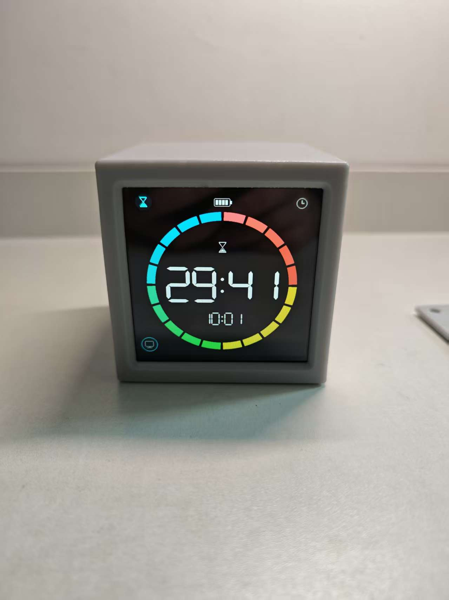
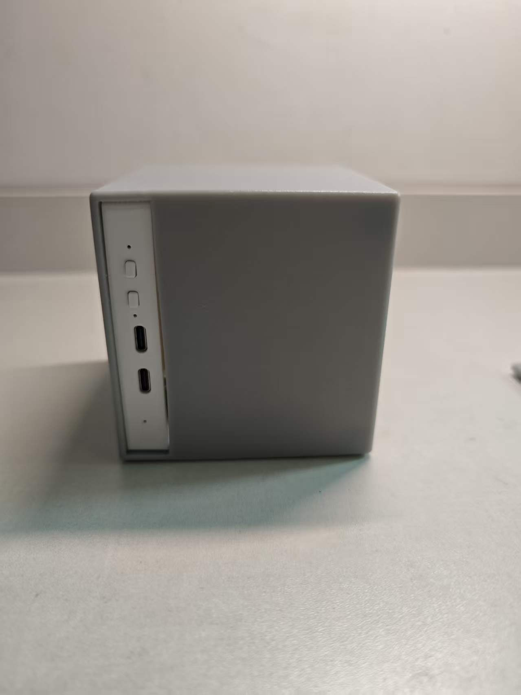
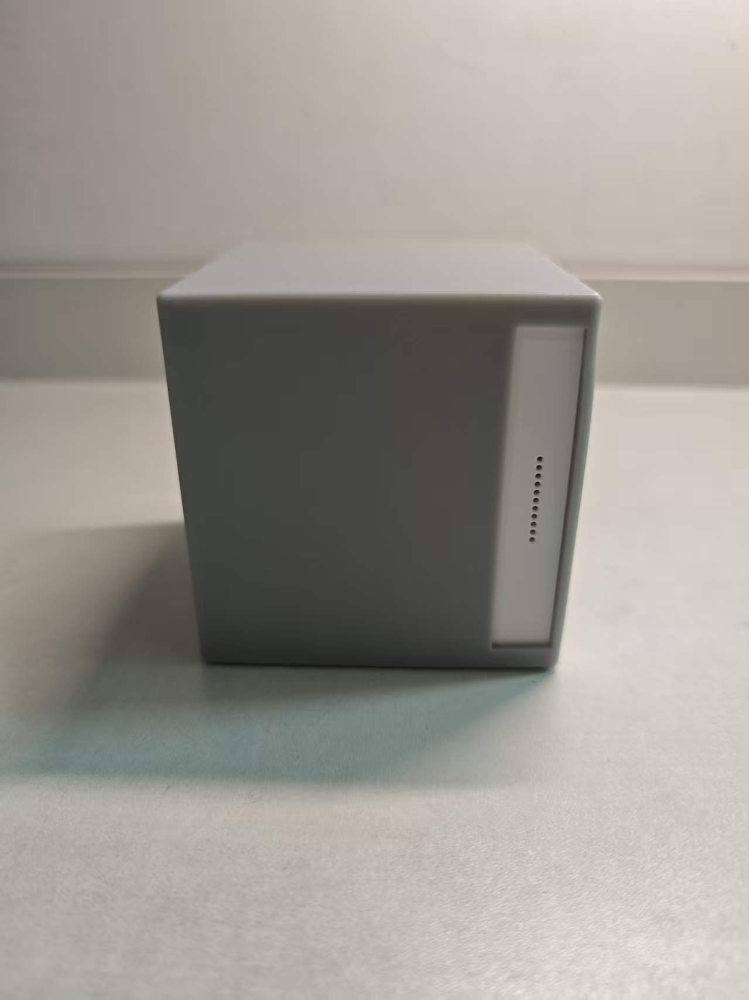
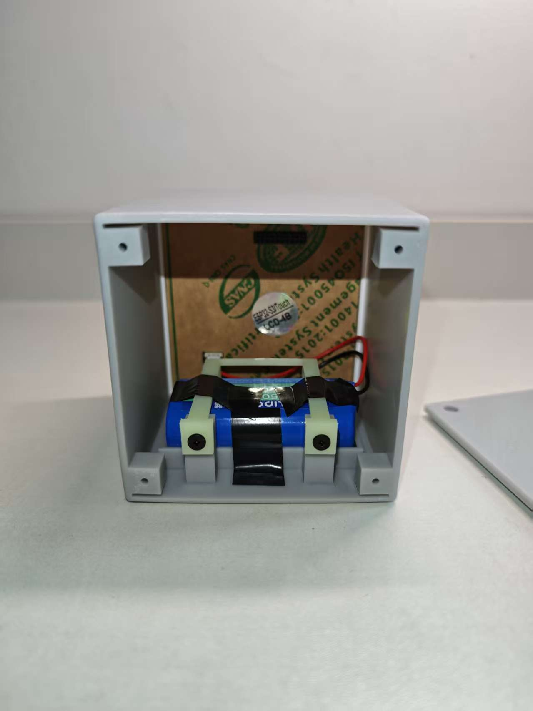
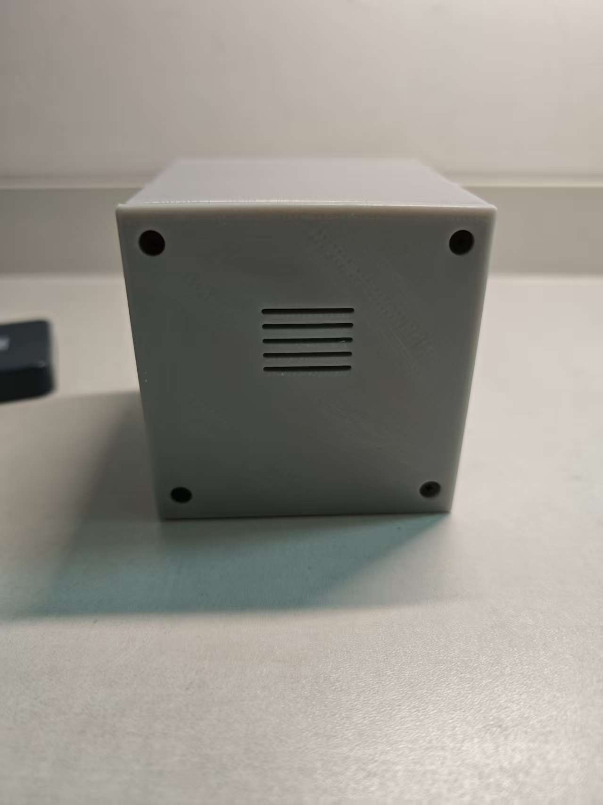
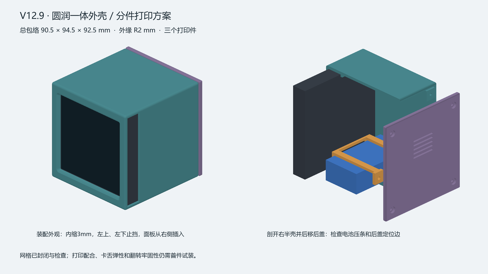
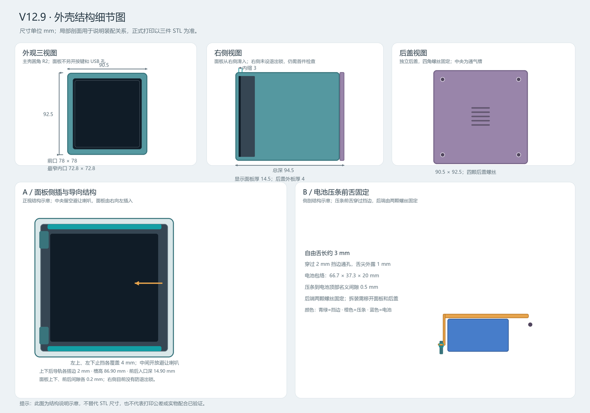
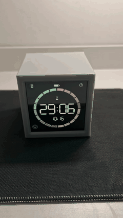

# 翻转番茄钟 Flip Pomodoro Timer

一个可以翻面选择时长的桌面番茄钟：以微雪 ESP32-S3 触摸屏开发板为核心，配合可充电锂电池、定制 3D 打印外壳和自绘界面，让翻转、计时和看时间都成为直观的桌面动作。

## 成品展示

<p align="center">
  
</p>

| 接口与按键侧面 | 扬声器侧面 |
| :---: | :---: |
|  |  |

| 电池与内部固定 | 后盖 |
| :---: | :---: |
|  |  |

### 外壳设计与实物对比

| V12.9 外壳模型：整体与内部结构 | 已装配实物：电池仓与压条 |
| :---: | :---: |
|  |  |

模型使用不同颜色区分主壳、后盖、电池与压条，实物采用 X 树脂打印。模型图中的尺寸为设计名义值；图内“仍需首件试装”为绘图时的历史备注，当前实物已完成照片所示装配，长期配合与牢固性仍需验证。



[查看外壳结构与打印文件](hardware/enclosure/README.md) · [查看三维总装模型](hardware/enclosure/v12.9/assembly.glb)

### 翻面与时钟演示

<p align="center">
  
</p>

[播放完整实物视频（MP4）](docs/media/demo.mp4)。视频展示翻面切换计时面、屏幕方向旋转及番茄钟与时钟页面切换；拍摄时的界面细节可能与当前固件略有不同。

## 功能与亮点

- **翻面选时**：四个侧面分别对应 5、10、30、60 分钟；切换到不同面时按对应时长重新计时。QMI8658 识别姿态，屏幕随方向旋转。
- **直观显示**：自绘数码字、20 段彩色剩余时间环与暂停标识；时钟页显示时间、秒数、日期和中文星期。
- **触摸与实体按键**：触摸切换页面或控制计时；BOOT 短按控制计时、长按重置。触摸热区随显示方向映射。
- **暂停与息屏**：向后翻平暂停，立回原面可恢复；屏幕朝下暂停并关闭面板和背光。也可手动息屏，轻触唤醒；倒计时完成后 30 秒无操作自动息屏。
- **柔和提示音**：开始、恢复和完成时播放电钢琴提示音，音频由后台任务处理。
- **电池与供电**：电池图标旁显示电量估算百分比，充电时显示闪电，低电量显示琥珀色；设备支持电池供电和 USB 供电。
- **桌面时钟**：开机可通过 Wi-Fi / NTP 同步板载 RTC；没有本地 Wi-Fi 配置时离线使用 RTC，时钟无效时显示占位符。
- **定制外壳**：树脂打印主壳、后盖和电池压条，预留侧面接口、按键及扬声器位置。

## 操作说明

| 操作 | 行为 |
| --- | --- |
| 番茄钟页翻到不同侧面 | 从该面的 5 / 10 / 30 / 60 分钟预设重新计时 |
| 向后翻平，屏幕朝上 | 暂停并保持屏幕点亮；立回原面恢复 |
| 屏幕朝下扣放 | 暂停并关闭面板和背光；翻回可见姿态恢复显示 |
| 点击番茄钟页空白处或短按 BOOT | 开始、暂停、继续；完成后重新开始当前面计时 |
| 点击顶部沙漏 / 时钟图标 | 切换页面，不重置当前计时；时钟页翻面仅旋转显示 |
| 点击左下显示器图标 | 息屏，计时继续；触摸先唤醒，不同时触发计时操作 |
| 长按 BOOT 至少 1.5 秒 | 重置计时 |
| 600ms 内双击 PWRKEY | 关机；关机后按 PWRKEY 开机 |
| USB 接入 / 拔除 | 状态稳定 1 秒后生效。计时运行中接入不切页、不暂停；非运行状态接入切到时钟页。拔除切到番茄钟页：待机时按稳定侧面启动，已有运行、暂停或完成状态保留 |

## 成本统计

按本次提供的采购及加工费用统计，单位为人民币：

| 项目 | 规格 | 金额 |
| --- | --- | ---: |
| 微雪触摸屏开发板 | ESP32-S3-Touch-LCD-4B，4 英寸、480×480 | ¥202.00 |
| 德力普锂电池组 | 18650，标称 3.7V、5200mAh | ¥24.59 |
| 定制外壳 | 嘉立创 X 树脂打印 | ¥47.89 |
| 十字薄头自攻螺丝 | M3×10 | ¥2.12 |
| **合计** | **上述四项费用** | **¥276.60** |

以上为本次记录的四项支出，不代表包含运费、工具、线材等其他可能费用，也不代表通用市场报价。电池容量为标称值，尚未完成容量和续航实测。

## 硬件与结构

| 部件 | 主要配置 |
| --- | --- |
| 主控与屏幕 | 微雪 ESP32-S3-Touch-LCD-4B，ESP32-S3、16MB Flash、8MB PSRAM，4 英寸 480×480 触摸屏 |
| 传感与触摸 | QMI8658 六轴传感器、GT911 触摸控制器 |
| 时间与电源 | PCF85063 RTC、AXP2101 电源管理 |
| 声音 | ES8311 音频编解码器与板载扬声器 |
| 电池 | 德力普 3.7V 5200mAh 18650 电池组；电量显示为芯片估算 |
| 外壳 | V12.9：主壳、后盖、电池压条；设计总包络约 90.5×94.5×92.5mm，为模型名义尺寸 |

详细接线、电池与充电说明见[硬件说明](docs/HARDWARE.md)；外壳 STL、结构及装配注意事项见[外壳说明](hardware/enclosure/README.md)。

## 构建与烧录

使用 Arduino CLI 1.5.1 和 `esp32:esp32@3.3.11`；仓库中的 `firmware/libraries/` 包含本项目需要的本地库及显示驱动补丁。构建时在项目根目录执行：

```bash
arduino-cli compile --fqbn esp32:esp32:esp32s3:CDCOnBoot=default,MSCOnBoot=default,DFUOnBoot=default,UploadMode=default,CPUFreq=240,FlashMode=qio,FlashSize=16M,PartitionScheme=app3M_fat9M_16MB,PSRAM=opi,LoopCore=1,EventsCore=1,EraseFlash=none --libraries "firmware/libraries" "firmware/FlipPomodoroTimer"
```

连接开发板 `USB TO UART` 口，将下方 `COM3` 替换为实际串口：

```bash
arduino-cli upload -p COM3 --fqbn esp32:esp32:esp32s3:CDCOnBoot=default,MSCOnBoot=default,DFUOnBoot=default,UploadMode=default,CPUFreq=240,FlashMode=qio,FlashSize=16M,PartitionScheme=app3M_fat9M_16MB,PSRAM=opi,LoopCore=1,EventsCore=1,EraseFlash=none "firmware/FlipPomodoroTimer"
```

需要联网校时时，将 `firmware/FlipPomodoroTimer/WiFiConfig.example.h` 复制为同目录 `WiFiConfig.local.h` 并填写配置；该文件已被 Git 忽略。**公开分享固件前应在没有私人配置的环境构建**。未配置 Wi-Fi 时可离线运行，RTC 需要已有有效时间。调试串口波特率为 115200。

## 验证与说明

实物照片展示了外壳、面板、电池安装及后盖；视频展示了翻面与页面切换。设备曾完成编译、烧录和写入校验；电池已通过短时独立供电检查，另一次 35 秒观察中系统运行且电源芯片持续报告充电。

图片和短时观察不能证明所有工况均已通过：完整充电周期、实际容量与续航、长期装配可靠性，以及最新 USB 插拔、电量图标和动画观感仍需进一步验证。外壳尺寸为模型名义值，右侧面板防脱、线束和螺丝配合请结合实物检查。更多信息见[验收说明](docs/UI-V6-VALIDATION.md)。

## 项目资料

- [硬件、电池与装配](docs/HARDWARE.md)
- [外壳文件与打印说明](hardware/enclosure/README.md)
- [提示音与测试](docs/AUDIO.md)
- [功能状态与验收说明](docs/UI-V6-VALIDATION.md)
- [开发与构建说明](docs/PLAN.md)
- [项目开发约定](AGENTS.md) · [本地库补丁](firmware/libraries/LOCAL_PATCHES.md) · [官方资料摘录](docs/ESP32-S3-Touch-LCD-4B官方资料.md)
