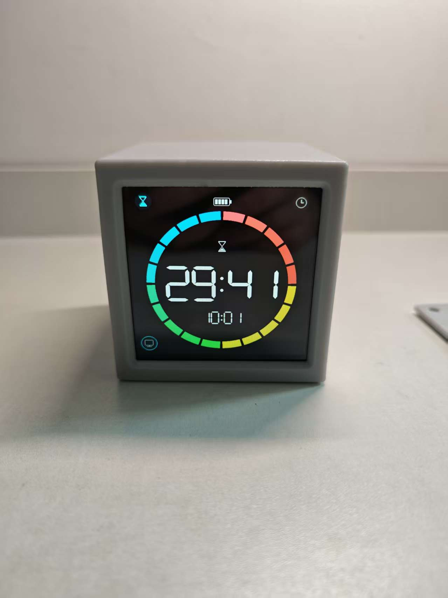
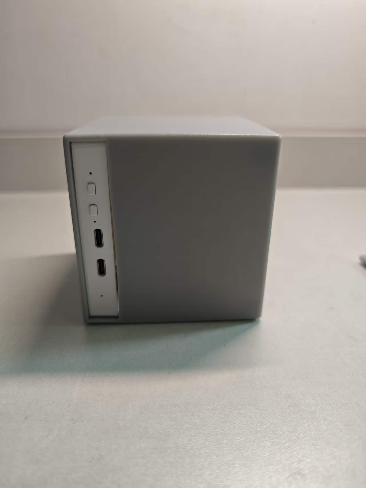
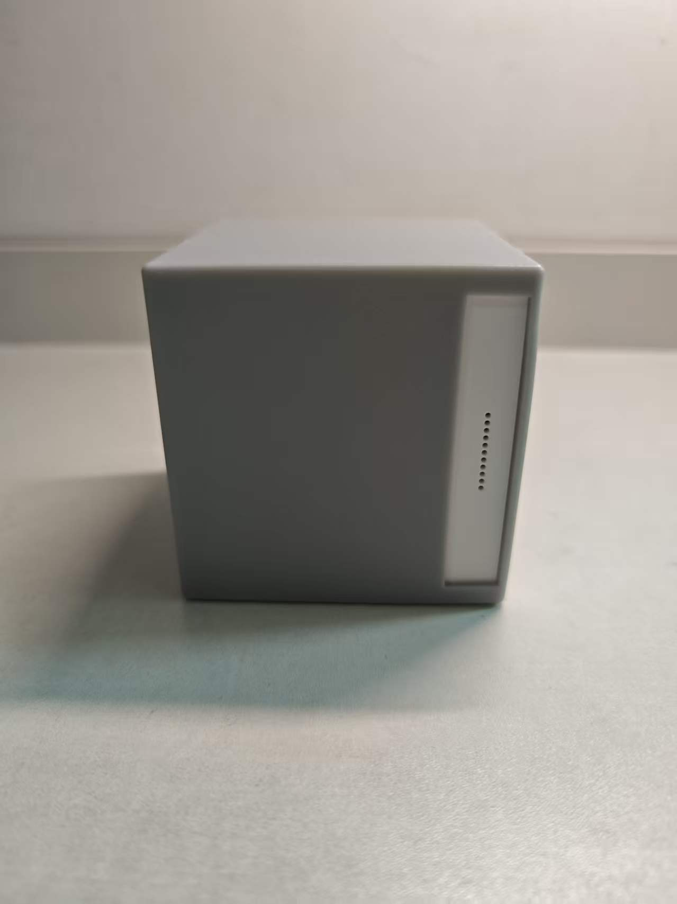
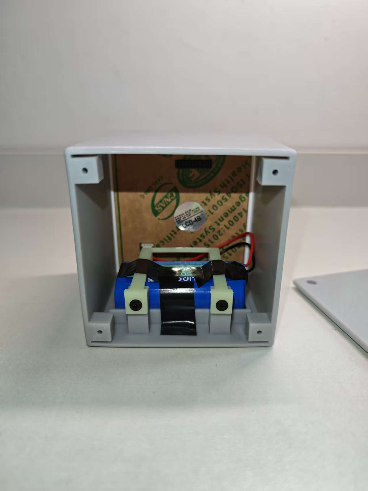
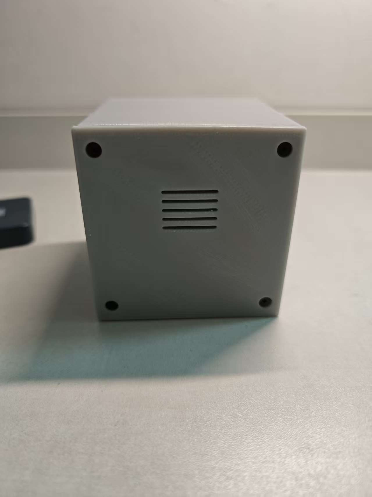
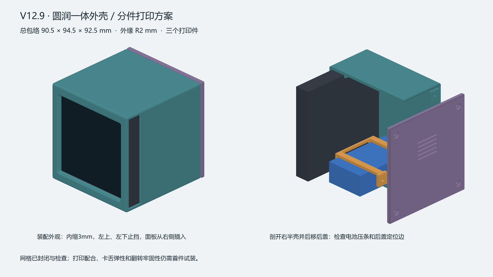
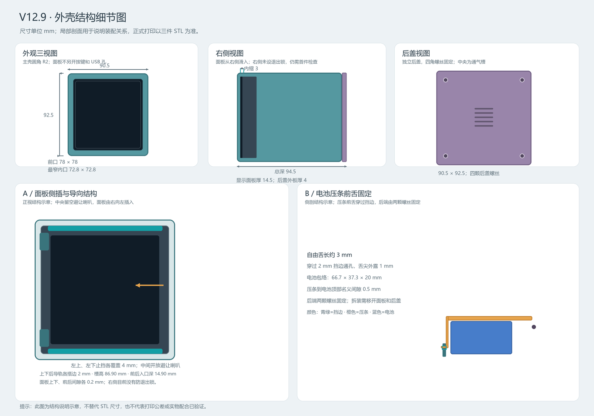
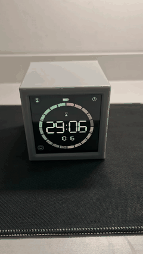

# 翻转番茄钟 Flip Pomodoro Timer

一个可以翻面选择时长的桌面番茄钟：以微雪 ESP32-S3 触摸屏开发板为核心，配合可充电锂电池、定制 3D 打印外壳和自绘界面，让翻转、计时和看时间都成为直观的桌面动作。

## 成品展示

<p align="center">
  
</p>

| 接口与按键侧面 | 扬声器侧面 |
| :---: | :---: |
|  |  |

| 电池与内部固定 | 后盖 |
| :---: | :---: |
|  |  |

### 外壳设计与实物对比

| V12.9 外壳模型：整体与内部结构 | 已装配实物：电池仓与压条 |
| :---: | :---: |
|  |  |

模型使用不同颜色区分主壳、后盖、电池与压条，实物采用 X 树脂打印。模型图中的尺寸为设计名义值；图内“仍需首件试装”为绘图时的历史备注，当前实物已完成照片所示装配，长期配合与牢固性仍需验证。



[查看外壳结构与打印文件](hardware/enclosure/README.md) · [查看三维总装模型](hardware/enclosure/v12.9/assembly.glb)

### 翻面与时钟演示

<p align="center">
  
</p>

[播放完整实物视频（MP4）](docs/media/demo.mp4)。视频展示翻面切换计时面、屏幕方向旋转及番茄钟与时钟页面切换；拍摄时的界面细节可能与当前固件略有不同。

## 功能与亮点

- **翻面选时与防误触预览**：四个侧面（面一至面四）默认分别对应 5、10、60、30 分钟；翻面 100ms~600ms 缓冲期显示目标面时长预览，稳定 600ms 后按对应时长开始计时。QMI8658 识别姿态，屏幕随方向旋转。
- **完整番茄工作流与统计**：支持专注完成后点击进入休息倒计时（默认 5 分钟），NVS 持久化记录今日与近 7 日专注统计，并可在统计页查看近 7 日柱状图及直接调节音量与屏幕亮度。
- **双计时模式（自由翻转 ⇄ 每日日程）**：番茄钟页与时钟页左下角均可一键切换「自由翻转番茄钟」与「每日日程模式」（同步移除原手动息屏按钮）。日程模式下预置 07:30–23:30 共 26 条每日作息/学习时间表（最多支持 32 条，不支持 0 分钟条目），到点自动弹窗提醒，支持触控或短按 BOOT 对齐时间表结束时刻倒计时，或点击「跳过本次」跳过当前时段；进入日程模式后锁定在番茄钟/日程页且计时不可暂停或手动重置，直至再次点击左下角退出日程模式；仅分类为「专注」的日程计入专注统计。
- **免重编译配网与 Web 控制台**：在统计页一键开启 Web 控制台，优先连接已保存 Wi-Fi（局域网浏览器直连设备 IP，无需切换手机网络）；若未配置或 8 秒内连不上，自动回退为 `FlipPomodoro-Setup` 热点（`192.168.4.1`，支持 Captive Portal），可直接配置 Wi-Fi、时区、四面时长、休息时长、音量、亮度、自动息屏时间、番茄钟/时钟页主题、整点报时开关、工作模式，以及在线增删改每日日程表（`/api/schedule`）。
- **直观显示与多款表盘主题**：支持在统计页右上角或 Web 控制台一键切换番茄钟页面的 **科技环 / Fliqlo 4 卡 3D 翻页 / 照片级 IN-18 辉光管 / 像素风小番茄 / 流沙沙漏** 共 5 款主题；时钟页支持通过右下角图标或 Web 控制台在 **极简天象时钟（24 小时昼夜渐变 + 4×4 Bayer 有序抖动 + 真实日月轨迹与实时月相 + 底部三层分形雾化山脉 + QMI8658 陀螺仪视差 + 深夜微闪星空与流星）** 与 **像素小猫 · 全屏时间小世界（无遮挡全景大落地窗融入带深色描边的圆润像素大时间、4 时段作息、斜射阳光光束、编织地毯、今日专注次数联动窗台盆栽成长、触控摸摸头爱心）** 之间切换，支持点击时间数字开启 **24H 昼夜实机演示模式**，并支持时钟页整点报时仪式（22:00–07:00 夜间自动免打扰，仅播视觉动效）。
- **触摸与实体按键**：顶部支持番茄钟 / 统计 / 时钟三页切换，触摸或 BOOT 短按控制计时、长按重置。触摸热区随显示方向映射。
- **暂停、多级调光与节能**：向后翻平暂停（背光自动微暗），立回原面恢复；屏幕朝下暂停并关闭面板和背光。熄屏时停止后台帧刷新并自动将 CPU 降频至 80MHz；倒计时完成后默认 30 秒无操作自动息屏，期间每 15 秒轻柔重响提示音（最多 3 次）。
- **柔和提示音**：开始、恢复和完成时播放电钢琴提示音，支持通过 Web 控制台调节音量（含静音），音频由后台任务处理并全程加 I2C 互斥锁。
- **电池与供电**：电池图标旁显示电量估算百分比，充电时显示闪电，低电量显示琥珀色；设备支持电池供电和 USB 供电。
- **零阻塞异步校时**：开机在后台异步连接 Wi-Fi / NTP 同步板载 RTC，并支持每 24 小时静默重校时；无 Wi-Fi 配置时离线使用 RTC。
- **定制外壳**：树脂打印主壳、后盖和电池压条，预留侧面接口、按键及扬声器位置。

## 操作说明

| 操作 | 行为 |
| --- | --- |
| 番茄钟页翻到不同侧面 | 自由模式：从该面的 5 / 10 / 60 / 30 分钟预设重新计时；日程模式：仅旋转显示方向，不覆盖当前日程时长 |
| 向后翻平，屏幕朝上 | 自由模式：暂停并保持屏幕点亮，立回原面恢复；日程模式：不暂停 |
| 屏幕朝下扣放 | 自由模式：暂停并关闭面板和背光；日程模式：仅息屏，不暂停 |
| 点击番茄钟页空白处或短按 BOOT | 自由模式：开始、暂停、继续、进入休息/重开；日程模式：计时不可暂停，仅在到点弹窗时可通过短按 BOOT 或点击「确定开始」开始计时，点击「跳过本次」跳过当前时段 |
| 点击番茄钟页或时钟页左下角日历图标 | 在「自由翻转番茄钟」与「每日日程模式」之间切换并保存到 NVS；在时钟页切入日程模式且当前处于某日程时段时，会直接弹出确认弹窗，点击「确定开始」或「跳过本次」后立即跳转到番茄钟页（已移除原各页左下角手动息屏按钮） |
| 点击顶部左上角切换图标 / 柱状图图标 | 自由模式：左一图标在番茄钟与时钟页间切换（显示目标页图标），柱状图图标进入专注统计页，不重置当前计时；日程模式：锁定在番茄钟页，除非退出日程模式否则不可切换其他页面 |
| 时钟页点击右下角图标 | 在「极简天象时钟」与「像素小猫 · 时间小世界」之间切换并保存到 NVS |
| 时钟页点击时间数字区域 | 开启或退出 **24H 昼夜实机演示模式**（约 32 秒快进循环全天，不改真实 RTC） |
| 像素小猫时钟页互动 | 点击小猫小屋触发 3 秒摸摸头爱心动画与短提示音 |
| 统计页点击右上角“主题”按钮 | 循环切换 5 款番茄钟表盘主题并保存到 NVS |
| 统计页点击“开启 Web 控制台 / 配网” | 优先连接已存 Wi-Fi 并显示局域网 IP；未配网或超时自动切换为 `FlipPomodoro-Setup` 热点（`192.168.4.1`）；再次点击或 10 分钟无操作自动关闭 |
| 长按 BOOT 至少 1.5 秒 | 重置计时 |
| 600ms 内双击 PWRKEY | 关机；关机后按 PWRKEY 开机 |
| USB 接入 / 拔除 | 状态稳定 1 秒后生效。计时运行中接入不切页、不暂停；非运行状态接入切到时钟页。拔除切到番茄钟页：待机时按稳定侧面启动，已有运行、暂停或完成状态保留 |

## 成本统计

按本次提供的采购及加工费用统计，单位为人民币：

| 项目 | 规格 | 金额 |
| --- | --- | ---: |
| 微雪触摸屏开发板 | ESP32-S3-Touch-LCD-4B，4 英寸、480×480 | ¥202.00 |
| 德力普锂电池组 | 18650，标称 3.7V、5200mAh | ¥24.59 |
| 定制外壳 | 嘉立创 X 树脂打印 | ¥47.89 |
| 十字薄头自攻螺丝 | M3×10 | ¥2.12 |
| **合计** | **上述四项费用** | **¥276.60** |

以上为本次记录的四项支出，不代表包含运费、工具、线材等其他可能费用，也不代表通用市场报价。电池容量为标称值，尚未完成容量和续航实测。

## 硬件与结构

| 部件 | 主要配置 |
| --- | --- |
| 主控与屏幕 | 微雪 ESP32-S3-Touch-LCD-4B，ESP32-S3、16MB Flash、8MB PSRAM，4 英寸 480×480 触摸屏 |
| 传感与触摸 | QMI8658 六轴传感器、GT911 触摸控制器 |
| 时间与电源 | PCF85063 RTC、AXP2101 电源管理 |
| 声音 | ES8311 音频编解码器与板载扬声器 |
| 电池 | 德力普 3.7V 5200mAh 18650 电池组；电量显示为芯片估算 |
| 外壳 | V12.9：主壳、后盖、电池压条；设计总包络约 90.5×94.5×92.5mm，为模型名义尺寸 |

详细接线、电池与充电说明见[硬件说明](docs/HARDWARE.md)；外壳 STL、结构及装配注意事项见[外壳说明](hardware/enclosure/README.md)。

## 构建与烧录

使用 Arduino CLI 1.5.1 和 `esp32:esp32@3.3.11`；仓库中的 `firmware/libraries/` 包含本项目需要的本地库及显示驱动补丁。采用标准 16MB 分区方案（`PartitionScheme=app3M_fat9M_16MB`），无需额外语音模型分区或自定义 `esp32s3-libs`。构建时在项目根目录执行：

```bash
arduino-cli compile --fqbn esp32:esp32:esp32s3:CDCOnBoot=default,MSCOnBoot=default,DFUOnBoot=default,UploadMode=default,CPUFreq=240,FlashMode=qio,FlashSize=16M,PartitionScheme=app3M_fat9M_16MB,PSRAM=opi,LoopCore=1,EventsCore=1,EraseFlash=none --libraries "firmware/libraries" "firmware/FlipPomodoroTimer"
```

烧录时连接开发板 `USB TO UART` 口并将下方 `COM3` 替换为实际串口：

```bash
arduino-cli upload -p COM3 --fqbn esp32:esp32:esp32s3:CDCOnBoot=default,MSCOnBoot=default,DFUOnBoot=default,UploadMode=default,CPUFreq=240,FlashMode=qio,FlashSize=16M,PartitionScheme=app3M_fat9M_16MB,PSRAM=opi,LoopCore=1,EventsCore=1,EraseFlash=none "firmware/FlipPomodoroTimer"
```

需要联网校时时，将 `firmware/FlipPomodoroTimer/WiFiConfig.example.h` 复制为同目录 `WiFiConfig.local.h` 并填写配置；该文件已被 Git 忽略。**公开分享固件前应在没有私人配置的环境构建**。未配置 Wi-Fi 时可离线运行，RTC 需要已有有效时间。调试串口波特率为 115200。

## 验证与说明

实物照片展示了外壳、面板、电池安装及后盖；视频展示了翻面与页面切换。最新固件已完成编译、烧录至 `COM3` 并通过写入校验，且在实机上观察确认了「极简天象时钟」午后渐变（4×4 Bayer 抖动）与三层分形雾化远山的显示效果；电池已通过短时独立供电检查，另一次 35 秒观察中系统运行且电源芯片持续报告充电。

图片和短时观察不能证明所有工况均已通过：完整充电周期、实际容量与续航、长期装配可靠性，以及最新「像素小猫」全时段作息、摸摸头互动、毛线球倾斜物理、整点报时与夜间免打扰、USB 插拔、电量图标和动画观感仍需进一步实机验证。外壳尺寸为模型名义值，右侧面板防脱、线束和螺丝配合请结合实物检查。更多信息见[验收说明](docs/UI-V6-VALIDATION.md)。

## 项目资料

- [硬件、电池与装配](docs/HARDWARE.md)
- [外壳文件与打印说明](hardware/enclosure/README.md)
- [提示音与测试](docs/AUDIO.md)
- [功能状态与验收说明](docs/UI-V6-VALIDATION.md)
- [开发与构建说明](docs/PLAN.md)
- [项目开发约定](AGENTS.md) · [本地库补丁](firmware/libraries/LOCAL_PATCHES.md) · [官方资料摘录](docs/ESP32-S3-Touch-LCD-4B官方资料.md)
