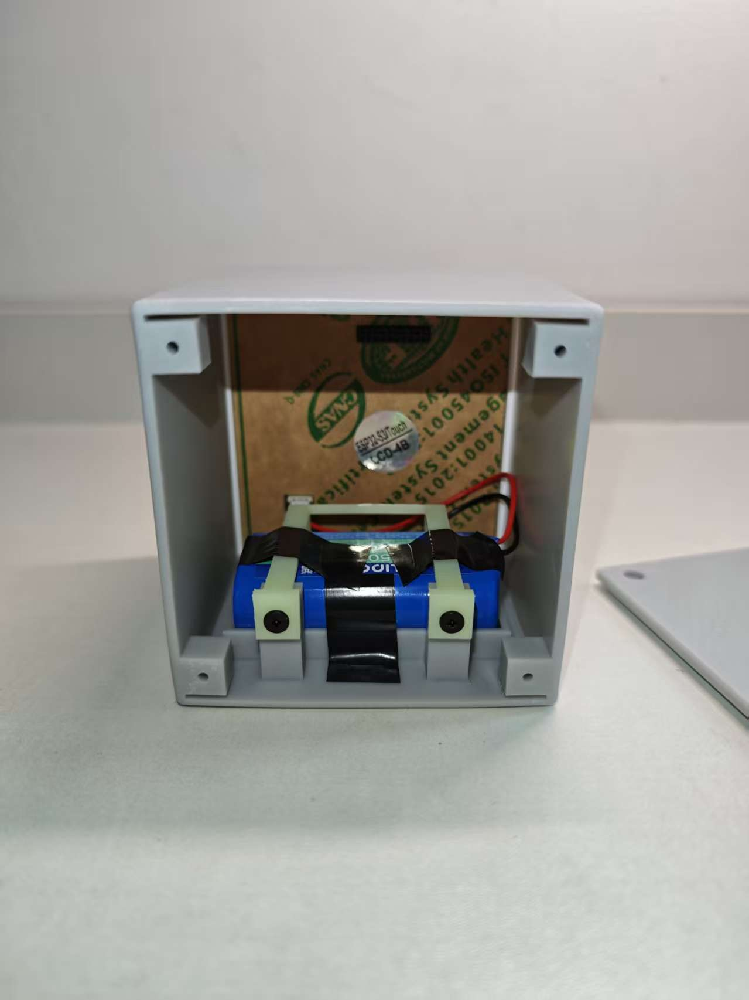

# 硬件与电源

## 成品配置

| 部件 | 型号 / 规格 | 作用 |
| --- | --- | --- |
| 主控与屏幕 | 微雪 ESP32-S3-Touch-LCD-4B；ESP32-S3，16MB Flash、8MB PSRAM；4 英寸 480×480 触摸屏 | 界面、控制与计算 |
| 姿态传感器 | QMI8658 | 识别侧面与翻转姿态 |
| 触摸控制器 | GT911 | 触摸输入 |
| 电源管理 | AXP2101 | USB / 电池供电管理、充电和电量估算 |
| 实时时钟 | PCF85063 | 保留时间、日期 |
| 音频 | ES8311 与板载扬声器 | 播放提示音 |
| 电池组 | 德力普 18650 锂电池组，标称 3.7V、5200mAh | 移动供电；容量未经本项目实测 |
| 外壳与紧固 | 嘉立创 X 树脂打印外壳；M3×10 十字薄头自攻螺丝 | 容纳面板、电池，固定压条和后盖 |

照片可见电池平放、压条固定和线束位置；照片反映当前装配状态，不作为绝缘完整性、跌落、长期耐久或线束受力合格的证明。电池外壳上可见的胶带也属于实物装配状态；照片不能证明其材料及安全等级。

## 电源与充电

开发板设有 USB 供电及 3.7V 单串锂电池接口。固件配置 AXP2101 充电终止电压 **4.2V**、恒流充电设置 **500mA**，显示电池估算百分比和充电状态。这是固件配置，不代表实际充电电流恒为 500mA，也不单独证明所接电池组的保护性能。

已观察到拔掉 USB 后电池可短时维持设备运行；一次 USB 接入测试中，连续 35 秒、35 次采样，系统运行且芯片持续报告充电，USB 电压约 4.963～4.976V、电池电压约 4.204～4.206V，电量估算 97%～98%。未测实际充电电流、完整充电周期、容量、温升和续航。

电池接口应核对插头正负极、实际电池组和保护板规格。该接口用于 **3.7V 单串（1S）锂电池组**，不能接入 7.4V 两串（2S）电池组。固定时避免挤压电池、刺破包膜或夹住线束。

## USB 与计时

USB 状态稳定 1 秒后：

- 接入时正在计时：保持当前页面和计时状态；非运行状态切换到时钟页。
- 拔除时切到番茄钟页；若原来待机，等待侧面稳定后按该面开始计时；已有运行、暂停或完成状态不被覆盖。
- 时钟页中翻面只调整显示方向，不自动启动隐藏倒计时。

具体操作和实机验收边界见[项目首页](../README.md)与[功能状态和验收说明](UI-V6-VALIDATION.md)。

## 主要接口

| 项目 | 引脚 / 地址 |
| --- | --- |
| I2C | SDA GPIO 47、SCL GPIO 48 |
| TCA9554 / AXP2101 / QMI8658 / PCF85063 / GT911 | `0x20` / `0x34` / `0x6B` / `0x51` / `0x5D` |
| LCD 背光 | GPIO 4；LOW 点亮、HIGH 关闭 |
| BOOT 按键 | GPIO 0，低电平有效 |
| ES8311 | I2C `0x18`；音频与 LCD 控制共用 TCA9554 |
| 串口 | `USB TO UART`；115200 波特率，串口号以实际连接为准 |

接线与引脚的完整定义以 [pin_config.h](../firmware/FlipPomodoroTimer/pin_config.h) 和[官方资料](ESP32-S3-Touch-LCD-4B官方资料.md)为准。外壳结构与打印文件见[外壳说明](../hardware/enclosure/README.md)。
