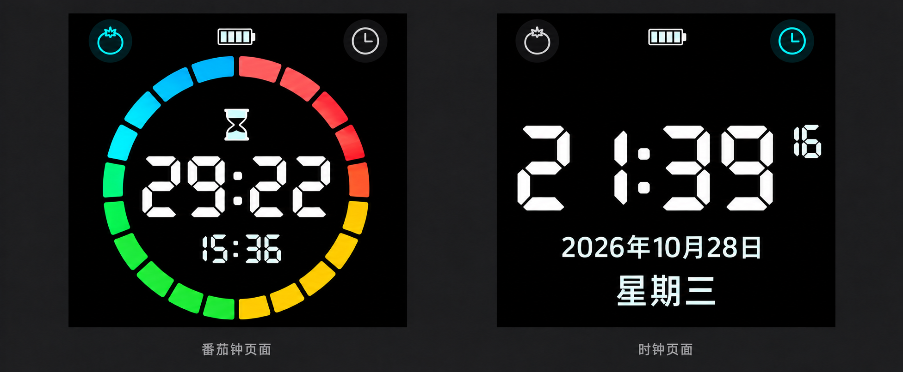
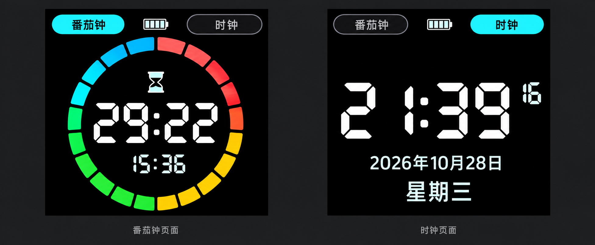
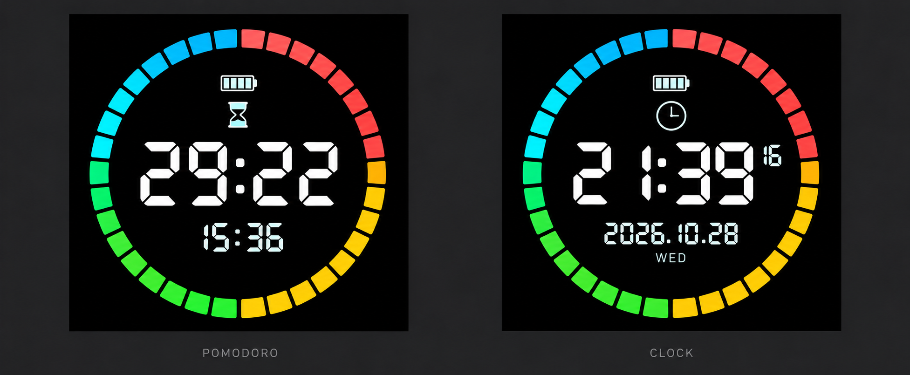
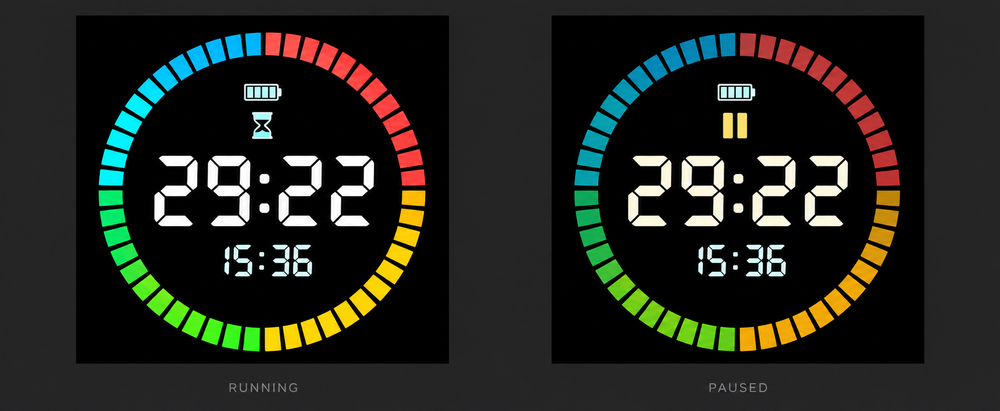

# 界面静态设计稿

日期：2026-10-28。状态：V5 已由用户确认并进入实现，图片为概念稿，并非实机截图。

## 执行状态

用户已确认采用 V5 并要求执行。显示层、图标、20 段圆环及方向响应已写入固件；下面“尚未接入”等说明为各稿评审时的历史状态，V5 烧录后用户反馈占屏偏小、字形模糊、秒更新闪动及方向跳变；当前按约定推进 V6，编译烧录与验证边界以 [V6 实现与验收记录](../UI-V6-VALIDATION.md) 为准。

## 当前采用稿 V5：沙漏与表盘模式图标

用户纠正：番茄钟模式按钮使用沙漏图标，不使用番茄图标。两页左上均改为沙漏，右上仍为表盘；当前模式青色高亮，另一模式灰色弱化。其余布局沿用 V4。

使用内置 image_gen 编辑 V4，提示为仅替换两页左上番茄图标为同尺寸、同位置、相近线宽的沙漏，保留其余配色、数字、日期、中文星期和圆环。图片为静态提案，尚未接入固件；实现时以本版沙漏/表盘图标规则为准。

## 历史稿 V4：图标模式按钮

用户要求模式切换使用两个小图标，去除按钮文字。本稿以左上番茄轮廓图标表示番茄钟，右上表盘图标表示时钟；当前模式青色高亮，另一模式灰色弱化，电量仍在顶部中间。

图标视觉尺寸目标约 24px，按钮触摸区域约 40×40px；最终热区按实机触控体验调整，并随屏幕方向旋转。V3 的大文字胶囊按钮不再作为实现目标。

其余要求沿用 V3：番茄钟 20 段四主色环、无面号/轮次/底部说明；时钟页无圆环，显示大时间、日期和中文星期。此图仍为静态提案，尚未接入固件。

使用内置 image_gen 基于 V3 编辑。提示规格：仅把两页顶部大文字按钮替换为小型图标按钮，左番茄右表盘，当前页青色高亮、非当前页灰色、顶部中央保留电量；其他文字、圆环、字体、配色和布局保留，不添加透视或反光。

## 历史稿 V3：20 段番茄钟环与无环时钟页

本轮用户确定的要求：

- 番茄钟圆环改为 20 段，四组主色各 5 段，组内轻微渐变。
- 时钟页完全移除彩色环，放大并舒展时间和日期布局。
- 星期使用中文，例如“星期三”。
- 两页上方均放置左侧“番茄钟”、右侧“时钟”按钮，可以通过按钮切换；当前页按钮高亮，另一个按钮弱化。

本稿布局提案：两按钮之间放小电量图标；番茄钟圆环下移，为顶部按钮留出独立空间，中央仍是大倒计时与下方小号当前时间；时钟页以大号 HH:MM、小号秒数、中文年月日和星期形成宽松的纵向层次。图外页面名不进入设备界面。

使用内置 image_gen 基于 V2 编辑。提示规格：双列平面黑色方屏，统一顶部中文模式按钮及高亮；左页完整 20 段圆环，每组 5 段、每段约 16°且间隔约 2°，外径约 360px，中心约 (240,274)，依次四组青蓝/红/黄橙/绿；显示 29:22 与 15:36；右页无环，显示 21:39、小秒数 16、2026年10月28日、星期三；无面号、轮次、说明、透视或反光。

V3 为静态概念稿，尚未接入固件；最终 20 段数量、四组各 5 段、圆弧几何与文字边距需在实际绘制代码中精确保证。后续模式按钮的触摸热区需与显示方向一并旋转，保证四个方向下均能正确切页。

## 历史稿 V2：减少分段与补充时钟页

用户反馈 V1 分段过密，要求参考视频细化圆环，同时补充时钟页面。

- 圆环目标减少至 32 段，每个主色区 8 段，块面更饱满、间隙规整、边角轻微圆润，组内只有轻微色调渐变。最终段数和几何由代码保证，生成图仅为视觉参考。
- 四主色及位置与 V1 一致：左上青蓝、右上红、右下黄橙、左下绿；不增加紫色等其他主色。
- 番茄钟页：中央大号 MM:SS，下方显示当前时间 HH:MM，上方小电量和沙漏图标。
- 时钟页：中央大号 HH:MM，右上小号秒数，下方显示日期及星期，上方小电量与时钟图标。日期和星期属于内容提案，尚待用户评审。
- 两页使用同一圆环、字号体系和边距；图外 POMODORO / CLOCK 标签不进入设备界面。
- V2 尚未实现到固件，不把静态图视为分段精度、动态效果或实机性能验收。

V2 通过内置 image_gen 编辑 V1 生成。提示规格：保留黑底、数码管字与平面布局；将圆环改为 32 段（每区 8 段）、约 392px 外径与 18px 厚度、均匀小间隙、轻微圆角与组内渐变；左图显示 29:22 与 15:36，右图显示 21:39、小秒数 16、2026.10.28 与 WED；无透视、反光、面号、轮次、操作说明或按钮。

## 历史稿 V1：运行与暂停

## 用户已确定的要求

- 去除整屏 3D 透视效果；用户实测反馈效果差且出现闪烁。
- 保留翻面时的实时方向转换和对应倒计时切换。
- 彩色环使用四个主色，每组内部有轻微渐变。
- 主界面移除面号、完成轮次和底部说明。

## 本稿提案

- 以 480×480 方屏为布局基准；完整居中圆环直径约 400px，四周约留 40px 边距。
- 圆环以青蓝、红、黄橙、绿四组主色构成；相邻段在同一组内做轻微色调变化，避免扩展成杂乱的全光谱彩虹。
- 沿用分段环的设计方向，最终段数、颜色和进度亮暗规则由代码精确控制；生成图的段数与几何比例仅供视觉参考。
- 中央 MM:SS 使用粗笔画七段数码字，宽约 285px、高约 100px。
- 下方当前时间 HH:MM 使用较小数码字，不加胶囊边框。
- 圆环内部上方显示小电量图标与运行/暂停图标。
- 左图运行状态为白色数字；右图暂停状态使用暖白数字、金色暂停标识及略暗圆环。这组状态颜色仍待评审。
- 图外 RUNNING / PAUSED 只用于对比说明，不显示在设备屏幕上。

## 实现与验证边界

本轮源码已移除 3D 引用、初始化、逐帧透视、快照抓取和倾斜时暂停常规刷新的分支，并删除 Perspective3D.h。保留原有四方向显示旋转、触摸坐标旋转和计时姿态事件。

移除 3D 后已使用 README 中的 Arduino CLI 目标参数完成编译，退出码为 0：Flash 使用 1,319,003 字节，静态 RAM 使用 48,332 字节。未烧录，实际闪烁及方向切换体验待实机检查；此编译结果不代表 V2 新界面已经实现。

原有姿态确认仍使用 600ms 稳定判断，因此不能把当前实现描述成连续跟手旋转。后续需评估将视觉方向响应与计时切面防抖分开，兼顾及时转换和避免误启动。是否采用连续二维旋转或短方向过渡动画，需要另行确认及评估性能；不恢复梯形压缩或侧光变暗。

新版字体、四主色圆环和删减辅助信息目前尚未接入固件。图中的纯黑、锐度和颜色是视觉目标，LCD 的实机黑位、亮度和拍摄效果需单独验收。

验收重点：四个方向均不遮挡圆环、数字居中、秒数更新不残影；翻面不经过黑屏或变形帧；暂停保留剩余时间；换面直接重新开始；触控位置与画面一致。

## 图像来源与生成提示

使用内置 image_gen 生成 ui-mockup 概念图，非最终字体或运行时位图资产。

提示规格：平面正视的黑色方屏，两栏展示运行与暂停；48 段完整圆环、直径约 400/480，左上青蓝、右上红、右下黄橙、左下绿，组内轻微渐变；中央大号七段数字 29:22，下方小号 15:36；顶部小电量与沙漏或暂停图标；移除面号、轮次、底部说明、按钮、日期、透视和反光。使用清晰、可在嵌入式屏幕实现的简洁视觉。
