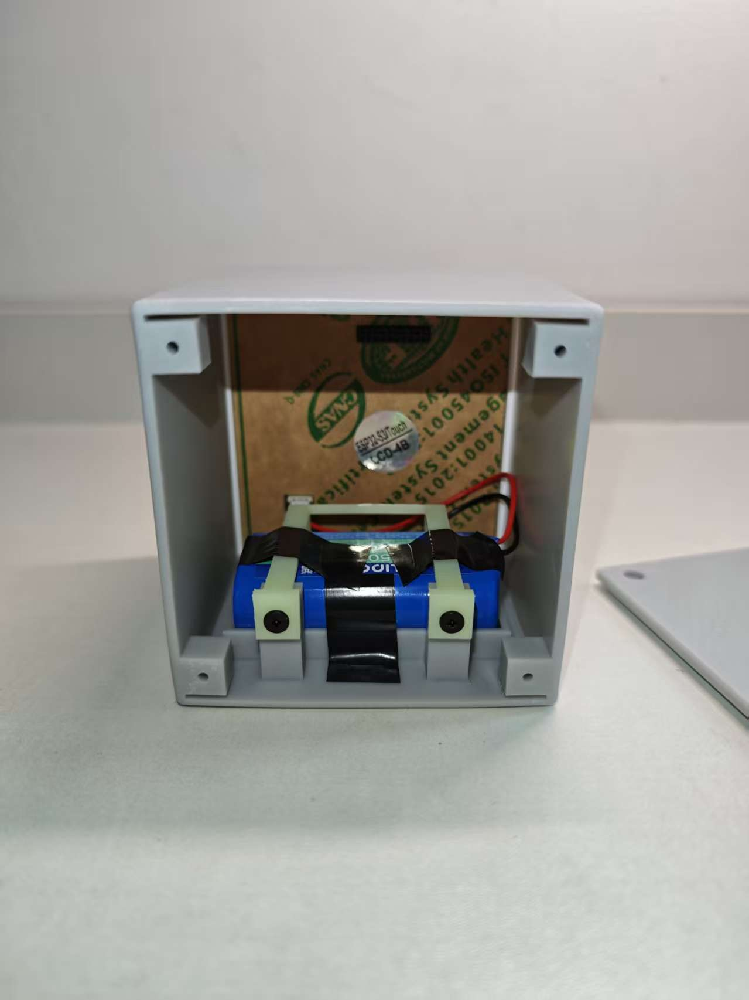

# V12.9 定制外壳

当前成品由一体主壳、后盖和电池压条组成，采用嘉立创 X 树脂打印。外壳为屏幕、侧面接口和扬声器留出位置；电池平放在底部托槽，由压条与螺丝固定。

[成品外观与演示](../../README.md) · [结构图](v12.9/details.png) · [彩色总装模型](v12.9/assembly.glb)

## 打印文件

以下三件各打印一件，单位为 mm，不要自动缩放：

- [V12.9-shell.stl](v12.9/V12.9-shell.stl)：主壳。
- [V12.9-lid.stl](v12.9/V12.9-lid.stl)：后盖。
- [V12.9-retainer.stl](v12.9/V12.9-retainer.stl)：电池压条。

也可使用 [V12.9 打印包](v12.9/print-package-v12-9.zip)。打印说明见 [PRINTING-V12.md](PRINTING-V12.md)，名义尺寸见 [FINAL-DIMENSIONS-V12.9.md](FINAL-DIMENSIONS-V12.9.md)。

## 装配与验证边界

外壳设计总包络约 **90.5×94.5×92.5mm**；这是模型名义尺寸，非成品实测。主壳包含屏幕侧插导轨、左侧止挡、电池托槽及后盖螺丝座；压条前舌穿入托槽挡边，后端用螺丝固定。后盖为四角螺丝固定并带开槽。

用户提供的照片显示外壳已打印、面板与电池已装入，不能由照片判断实际尺寸、公差、屏幕右侧防脱强度或长期可靠性。请在拆装时检查线束、正负极和电池包膜，避免夹线及压迫电池；反复拆装、螺纹寿命和材料耐久尚未验证。

模型由 [build_v12.py](build_v12.py) 生成，依赖见 [requirements-cad.txt](requirements-cad.txt)。窗口尺寸与视角假设见[屏幕开口检查](SCREEN-OPENING-CHECK.md)。
